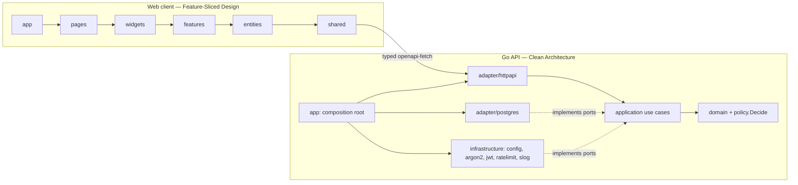

# SEN Support Platform

A privacy-conscious web platform for coordinating support sessions and sharing development observations between a child's parents/guardians and assigned specialists.

> **Status: university MVP prototype (25 October 2026).** The Go API, PostgreSQL integration, authorization rules, audit trail and React client on the real API are implemented and locally verified as described below. Password reset, field-level encryption, container security scans and usability evaluation remain open. Submission tag: `pre-defense-1`.

- **Repository:** https://github.com/AknurOE/sen-support-platform
- **YouTrack project:** https://honchikon1.youtrack.cloud/projects/SSP
- **Supervisor:** A. K. Makatov

---

## Problem statement

Families of children with special educational needs (SEN) often coordinate appointments, observations and agreed support across home, school and specialist settings. This information is scattered across messengers, calendars, paper notes and separate apps, and there is no shared place where a guardian decides **who sees which observation**.

This project designs and prototypes a shared workspace for these coordination tasks with server-enforced access control and auditable changes. It **does not** diagnose a child, prescribe interventions, or act as an official medical record.

## Target users

| User | What they need |
|---|---|
| Parent / legal guardian | Plan sessions, record observations, control visibility of each entry, revoke access |
| Assigned specialist (e.g. speech therapist, teacher, tutor) | See assigned children only, add session notes and diary entries within granted permissions |
| Platform administrator | Manage accounts and assignments, without access to diary text by default |
| Guest | View public pages, register, log in; no access to child data |

## Aim and expected outcomes

**Aim:** design and evaluate a web platform prototype in which an authorized guardian and an assigned specialist coordinate support sessions and keep a visibility-controlled developmental diary, with server-side access checks and an audit trail.

**Expected outcomes:**

- an evidence-traceable requirements and architecture package;
- an interactive prototype and, in later milestones, a working web application (MVP);
- a threat model, access matrix, data inventory and verification report;
- a comparison of the prototype with a baseline, with documented limitations.

Full objectives and success criteria: [docs/proposal.md](docs/proposal.md).

## Scope

**Planned MVP:** account access; guardian/specialist relationships; minimized child profile; session planning and status; diary entries with visibility levels; edit history and audit events; responsive web UI; role- and relationship-based authorization; synthetic test data; security and usability evaluation.

**Out of scope:** clinical diagnosis or recommendations, video calls, billing, school/clinic integrations, automated decisions, production hosting of real children's data, and any claim of legal compliance (GDPR / Kazakhstan law) without specialist review.

## Current status

Status on 25 October 2026 (branches SSP-50…SSP-56). Every "done" row links to the command that proves it; see [verification-plan §11](docs/verification-plan.md#11-results--25-october-2026-ssp-56).

| Area | State | Evidence |
|---|---|---|
| REST API contract (OpenAPI 3.1, problem+json) | **Implemented** | `make contract-lint`; `TestRoutesMatchOpenAPI` keeps routes == contract |
| Go API: auth (Argon2id, JWT + rotated refresh cookie, CSRF), RBAC + relationship + visibility, children, team, sessions, versioned diary, export/delete, audit | **Implemented** | Go unit/integration/contract suite; access matrix and IDOR tests |
| Access matrix / IDOR tests (run first in CI) | **Implemented** | `TestAccessMatrix100PercentCells`, `TestCrossFamilyIDORReturns404OnEveryEndpoint` |
| Web client on the real API (React 19, FSD, kz/ru/en) | **Implemented** | `make frontend-test`, `npm run test:e2e` (Playwright + axe: 6/6, 0 violations) |
| Docker images, compose, nginx with CSP | **Build and runtime verified locally** with synthetic credentials and a fresh isolated database | Compose API and web health checks passed |
| Trivy image scan | **Not run** | No verified CI scan result yet |
| ZAP baseline | **Not run** | No verified nightly scan result yet |
| Load test | Run locally | k6 50 VU: p95 6.19 ms, 0 % errors ([loadtest/](loadtest/README.md)) |
| Password reset and field-level encryption | **Planned / open** | [ADR-0007](docs/decisions/ADR-0007-scope-assumptions.md) |
| Audit-table DB-role hardening | **Implemented** | `TestApplicationRoleCannotTamperWithAuditRows`; runtime API uses `ssp_app`, which has no UPDATE/DELETE privilege |
| Parent-owned diary-entry deletion | **Implemented** | `TestAccessMatrix100PercentCells`, `TestCrossFamilyIDORReturns404OnEveryEndpoint`, `TestDiaryDeletionOwnerOnlyAndAudited` |
| Audit retention | **Implemented as an operator-run command** (365 days default; configurable) | `api retention`; `TestRetentionDeletesOnlyExpiredAuditEvents` |
| Usability study (SF-08), interviews (SF-02) | **Not conducted** | [usability plan](docs/frontend/usability-plan.md) |
| Legal classification, consent model, hosting | Open questions — **no compliance is claimed** | [legal checklist](docs/kazakhstan-privacy-legal-checklist.md) |

## User research and its limits

An anonymous exploratory survey (Google Forms) was run on 22–23 October 2026 with **seven respondents**: three parents/guardians and four specialists (two speech therapists, one teacher, one tutor). The link was shared in WhatsApp, Telegram and other messaging groups.

The sample is small and self-selected, so the results are **preliminary and not representative**. Findings are mapped to requirements, and assumptions are marked separately from observed findings, in [evidence-to-requirements](docs/research/evidence-to-requirements.md); method and limits: [survey-method](docs/research/survey-method.md); personas: [personas](docs/research/personas.md). The raw export is not committed because one response contains personal contact information. No usability results are claimed.

## Technology stack

| Layer | Choice | Decision |
|---|---|---|
| Frontend | React 19, TypeScript (strict), Vite 8, Tailwind CSS 4, React Router 7, TanStack Query, openapi-fetch (types generated from the contract), i18next, react-hook-form + zod, Radix Dialog | [ADR-0002 FSD](docs/decisions/ADR-0002-frontend-fsd.md) |
| Backend | Go 1.26, `net/http` ServeMux, Clean Architecture (domain → application → adapters), pgx v5 with hand-written parameterised SQL | [ADR-0001](docs/decisions/ADR-0001-backend-clean-architecture.md), [ADR-0003](docs/decisions/ADR-0003-sql-layer.md) |
| Database | PostgreSQL 17, embedded migrations | hosting not decided (SF-05) |
| Auth | Argon2id; 15-min JWT (HS256, pinned alg/iss/aud) in memory; opaque refresh token in HttpOnly SameSite=Strict cookie with rotation and reuse detection; CSRF double-submit + Origin check | [ADR-0004](docs/decisions/ADR-0004-tokens-and-csrf.md) |
| Quality | golangci-lint (depguard enforces layers), eslint-plugin-boundaries (enforces FSD), Vitest + Testing Library + MSW, Playwright + axe, k6, govulncheck, npm audit, gitleaks, Trivy, ZAP | [verification plan](docs/verification-plan.md) |



## Getting started

### Prerequisites

- Go 1.26+, Node.js 20.19+ (CI uses 22), npm
- PostgreSQL 17 binaries **or** Docker (tests start a throwaway PostgreSQL via `initdb` when `TEST_DATABASE_URL` is unset)

### Full stack in Docker

```bash
cp .env.example .env   # replace example passwords and JWT_SECRET (openssl rand -hex 32)
make dev               # db (127.0.0.1 only) → migrate → api → web
make seed              # synthetic demo users and one child (PRV-08)
open http://localhost:8081
```

### Without Docker

```bash
export DATABASE_URL=postgres://…/ssp JWT_SECRET=$(openssl rand -hex 32) COOKIE_SECURE=false \
       CORS_ALLOWED_ORIGINS=http://localhost:5174
cd backend && go run ./cmd/api migrate && go run ./cmd/api seed && go run ./cmd/api serve
cd frontend && npm ci && npm run dev    # http://localhost:5174, /api proxied to :8080
```

Demo accounts (synthetic): `admin@`, `specialist1@`, `specialist2@`, `parent1@`, `parent2@example.test`, password `Synthetic-Demo-2026`. Production admins are created with `api bootstrap-admin`, never via public sign-up.

### Tests and checks

```bash
make tools && make install
make check        # lint (Go, ESLint+FSD boundaries, OpenAPI, ≤300-line files) + typecheck + tests with coverage gates + build + bundle budget
make e2e          # Playwright + axe against an API on :8080 with seeded data
make vuln         # govulncheck + npm audit
```

## Documentation by pre-defense component

| # | Component | Where |
|---|---|---|
| 1 | Project proposal | [docs/proposal.md](docs/proposal.md) |
| 2 | Evidence of relevance | [docs/research/](docs/research) — [survey method](docs/research/survey-method.md), [evidence → requirements](docs/research/evidence-to-requirements.md), [personas](docs/research/personas.md) |
| 3 | Literature review | [docs/literature-review.md](docs/literature-review.md), [UX sources](docs/frontend/literature-ux.md), [security sources](docs/security-and-rbac-sources.md) |
| 4 | Existing systems comparison | [docs/existing-systems-comparison.md](docs/existing-systems-comparison.md), [criteria](docs/existing-systems-criteria.md), [security criteria](docs/system-security-criteria.md) |
| 5 | Technology comparison | [docs/technology-comparison.md](docs/technology-comparison.md), [frontend](docs/frontend/tech-comparison.md), [auth/session](docs/decisions/authentication-and-session-decisions.md) |
| 6 | Requirements | [docs/requirements.md](docs/requirements.md), [SRS](docs/srs.md), [security & privacy](docs/security-privacy-requirements.md), [UI requirements](docs/frontend/ui-requirements.md), [traceability matrix](docs/traceability-matrix.md) |
| 7 | Architecture and diagrams | [docs/architecture.md](docs/architecture.md) — context, use case, component and ER diagrams as Mermaid sources; DFD source in [docs/diagrams/dfd.mmd](docs/diagrams/dfd.mmd); PNG/SVG exports and binary documents in [docs/assets/](docs/assets/) |
| 8 | UX / prototype | [frontend/](frontend), [UX scenarios](docs/ux-scenarios.md), [prototype/README.md](prototype/README.md) |
| 9 | Verification and evaluation plan | [docs/verification-plan.md](docs/verification-plan.md), [usability plan](docs/frontend/usability-plan.md) |
| 10 | Project management and risks | [docs/project-management.md](docs/project-management.md), [YouTrack](https://honchikon1.youtrack.cloud/projects/SSP) |
| 11 | Supervisor feedback | [docs/supervisor-feedback.md](docs/supervisor-feedback.md) |

Security, privacy and legal documents: [RBAC and threat model](docs/rbac-and-threat-model.md), [data inventory](docs/data-inventory.md), [incident response](docs/incident-response.md), [prototype security review](docs/prototype-security-review.md), [legal checklist](docs/kazakhstan-privacy-legal-checklist.md). Submission summary: [submissions/pre-defense-1.md](submissions/pre-defense-1.md).

## Team

| Team member | Role | Responsibilities |
|---|---|---|
| Ondasyn Aknur (SE-2420) | Security, privacy and QA | Security/privacy requirements, access control, threat model, verification plan, legal analysis, risk register, submission tags |
| Zhumagali Beibarys (SE-2423) | Backend and architecture | Scope, SRS, architecture, API contract, technology comparison, domain model, repository infrastructure |
| Zhuparbai Yerkebulan (SE-2423) | Frontend and UX | User research and flows, personas, mockups, clickable prototype, UX comparison |

Shared: literature review, system comparison, README and consistency review. Milestones, dependencies and the risk register: [docs/project-management.md](docs/project-management.md).

## Repository structure

```text
.
├── backend/
│   ├── cmd/api/                 # serve | migrate | seed | bootstrap-admin | healthcheck
│   ├── internal/domain/         # entities, invariants, policy.Decide (pure)
│   ├── internal/application/    # use cases + ports
│   ├── internal/adapter/        # httpapi (handlers, middleware), postgres (repositories)
│   ├── internal/infrastructure/ # config, security, ratelimit, logging
│   ├── migrations/              # embedded SQL migrations
│   └── tests/                   # integration (real PostgreSQL) and contract tests
├── frontend/src/{app,pages,widgets,features,entities,shared}   # FSD layers
├── frontend/e2e/                # Playwright + axe
├── deploy/nginx.conf            # SPA + /api proxy + CSP
├── loadtest/                    # k6 scenario and result
├── docs/                        # contract, ADRs (docs/decisions), research, security, verification
└── .github/                     # CI (rbac-idor first), ZAP nightly, templates, CODEOWNERS
```

## Known limitations and next steps

- Rate limiting is in-memory per instance; a shared store is needed for more than one API replica.
- Docker images, compose and nginx were built and started locally with synthetic credentials in an isolated Compose project. Trivy and ZAP scans remain unverified.
- Not implemented (documented as planned): password reset and field-level encryption.
- Audit retention runs when an operator or scheduler invokes `api retention`; default age is 365 days (`AUDIT_RETENTION_DAYS`).
- Consent is a single recorded checkbox with a policy version — legal adequacy is an open question for the university lawyer (SF-11).
- Usability testing with 5 users and interviews have not been conducted.
- PR review by another team member is a process step the team still has to carry out on GitHub (SF-10).

## Git workflow

- `main` is the reviewed baseline; work happens in task branches named after the YouTrack ID.
- Every change goes through a pull request that explains the change, references the task and says how it was checked. Another team member reviews it before merging.
- Each member commits from their own GitHub account.

```text
Task:    SSP-23 – Define the database schema
Branch:  SSP-23-database-schema
Commit:  SSP-23: Add initial database schema and ER diagram
```

- Submission tags `pre-defense-1`, `pre-defense-2`, `final-pre-defense` are created on the submitted commit and are never moved.
- Git history, pull requests and review comments are available in the GitHub repository.

## Data and privacy

Use synthetic data only. Do not commit credentials, real child data or identifiable survey responses. The diary may contain health-related information about children, so legal classification, consent, retention and hosting decisions are open and are listed in the project documents as assumptions, not as compliance claims.

## License

The authors have not approved an open-source license. The repository remains all-rights-reserved under the explicit interim decision recorded in [LICENSE](LICENSE); reuse requires written permission.

## Development status

| Phase | Branch | Result |
|---|---|---|
| 0 Repo hygiene | SSP-50-repo-foundation | Implemented; `make check` and CI configuration exist |
| 1 Contract + ADRs | SSP-51-contract-adrs | Implemented; OpenAPI v0.2, ADR-0001…0008 |
| 2–3 Backend | SSP-52-backend-access, SSP-53-backend-diary | Implemented; Clean Architecture API, access/IDOR tests |
| 4 Frontend | SSP-54-frontend-fsd | Implemented; FSD client on the real API, ADR-0009 |
| 5 QA/DevOps | SSP-55-qa-devops | CI and container configuration implemented; image/Trivy/ZAP execution not yet verified |
| 6 Docs | SSP-56-docs | Implemented; traceability and local verification results documented |
