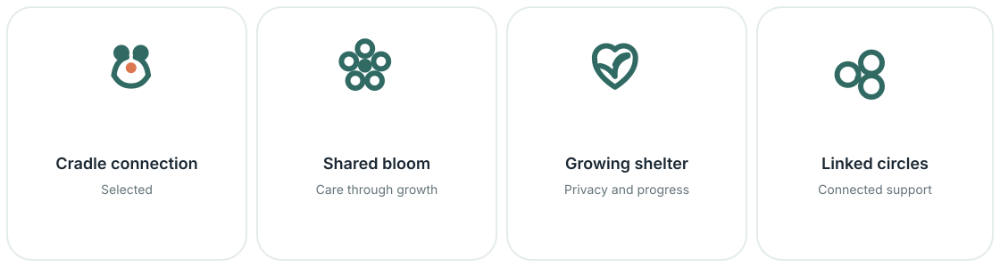

# SEN Support logo

The two open, rounded forms stand for a parent and an assigned specialist; together they cradle the smaller coral child mark.
The open center keeps the symbol warm and collaborative, while its balanced cradle hints at privacy and care without using a generic shield.
The wordmark remains live Inter text; the SVG mark has its own accessible name and uses the existing brand and accent tokens.
Keep clear space equal to one child-mark radius around the symbol; at 16 px use the standalone simplified mark, with no wordmark.

## Concepts considered

- **Cradle connection (selected):** two caregivers form a calm frame around a child.
- **Shared bloom:** a simplified version of the existing flower, with petals meeting at one center.
- **Growing shelter:** a rounded shield opening into a pair of leaves.
- **Linked circles:** three connected circles forming one continuous support network.

The selected geometry keeps two caregiver forms and one child visible at favicon size, while the lower arc creates a subtle protective cradle in the negative space.
