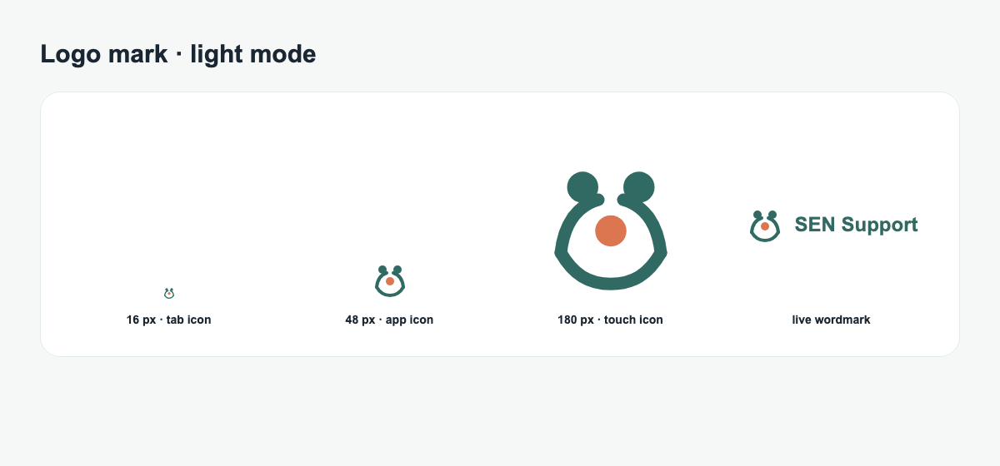
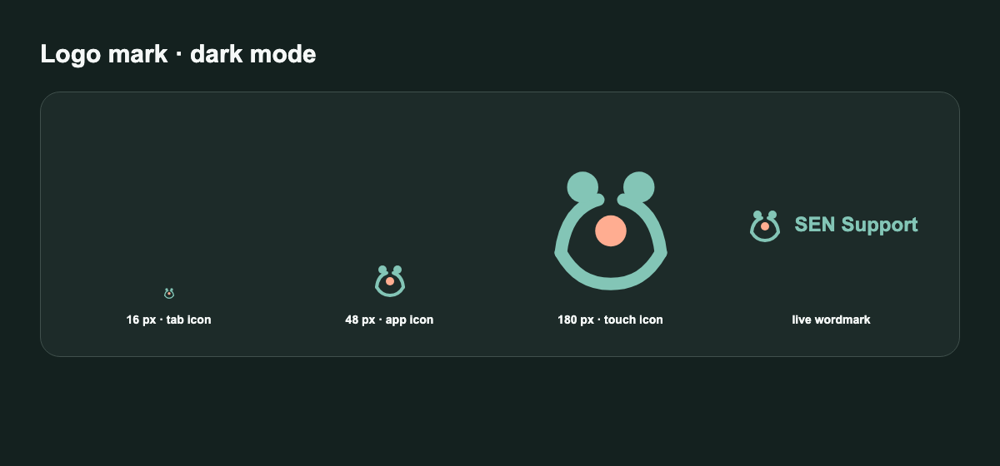
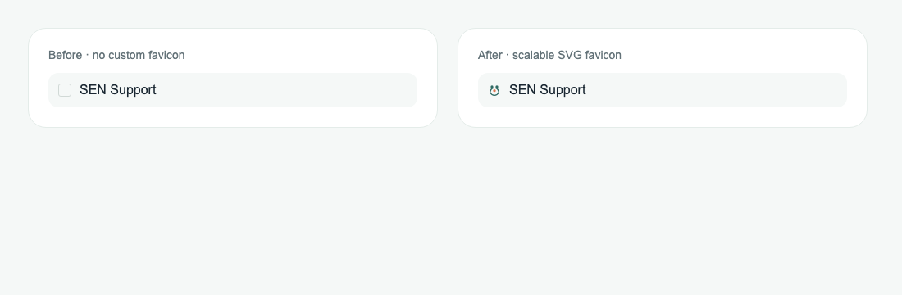

# Frontend polish and logo refresh

All screenshots below are 1440 × 1000. Before and after sets use the same isolated synthetic seed data; light and dark sets were rendered with `prefers-reduced-motion: reduce`.

## Screen notes

- **Landing:** stronger hero framing, soft brand gradient and depth, lift feedback on feature/role cards, restrained brand-mark motion.
- **Login, register, forgot password, reset password:** shared auth panel hierarchy, token-driven focus states, clearer field surfaces, refined brand panel and mark.
- **Dashboard:** larger greeting hierarchy, staggered child cards, gentle hover depth and a pop on the server-provided diary count.
- **Child profile:** clearer page heading and a lifted profile surface.
- **Schedule:** consistent page heading, staggered session list and responsive hover/press feedback.
- **Diary:** clearer heading and filters, staggered entries, refined shared loading/empty/error states.
- **Team:** clearer page hierarchy, staggered guardian/specialist rows and card depth.
- **Access log:** shared page hierarchy and improved loading/error/empty surfaces.
- **Admin users:** stronger title/action hierarchy and consistent table surface and status styling.
- **Admin audit:** shared page hierarchy, table surface and refined loading/error states.
- **Not found:** centered surface with a calm, legible recovery action.

## Logo direction

The selected cradle mark combines two caregiver forms, a small coral child, and a protective open arc. Three alternate directions and the selection are shown in [the concept board](./logo-concepts.svg); rationale and spacing rules are in [logo-rationale.md](./logo-rationale.md).

No animation library was added. CSS motion remains subtle and is disabled by the existing reduced-motion preference; static screenshot rendering used that preference.

## Before/after screenshots

| Screen | Light | Dark |
| --- | --- | --- |
| Landing | [Before](./screenshots/ui/landing-light-before.png) · [After](./screenshots/ui/landing-light-after.png) | [Before](./screenshots/ui/landing-dark-before.png) · [After](./screenshots/ui/landing-dark-after.png) |
| Login | [Before](./screenshots/ui/login-light-before.png) · [After](./screenshots/ui/login-light-after.png) | [Before](./screenshots/ui/login-dark-before.png) · [After](./screenshots/ui/login-dark-after.png) |
| Register | [Before](./screenshots/ui/register-light-before.png) · [After](./screenshots/ui/register-light-after.png) | [Before](./screenshots/ui/register-dark-before.png) · [After](./screenshots/ui/register-dark-after.png) |
| Forgot password | [Before](./screenshots/ui/forgot-password-light-before.png) · [After](./screenshots/ui/forgot-password-light-after.png) | [Before](./screenshots/ui/forgot-password-dark-before.png) · [After](./screenshots/ui/forgot-password-dark-after.png) |
| Reset password | [Before](./screenshots/ui/reset-password-light-before.png) · [After](./screenshots/ui/reset-password-light-after.png) | [Before](./screenshots/ui/reset-password-dark-before.png) · [After](./screenshots/ui/reset-password-dark-after.png) |
| Dashboard | [Before](./screenshots/ui/dashboard-light-before.png) · [After](./screenshots/ui/dashboard-light-after.png) | [Before](./screenshots/ui/dashboard-dark-before.png) · [After](./screenshots/ui/dashboard-dark-after.png) |
| Child profile | [Before](./screenshots/ui/child-profile-light-before.png) · [After](./screenshots/ui/child-profile-light-after.png) | [Before](./screenshots/ui/child-profile-dark-before.png) · [After](./screenshots/ui/child-profile-dark-after.png) |
| Schedule | [Before](./screenshots/ui/schedule-light-before.png) · [After](./screenshots/ui/schedule-light-after.png) | [Before](./screenshots/ui/schedule-dark-before.png) · [After](./screenshots/ui/schedule-dark-after.png) |
| Diary | [Before](./screenshots/ui/diary-light-before.png) · [After](./screenshots/ui/diary-light-after.png) | [Before](./screenshots/ui/diary-dark-before.png) · [After](./screenshots/ui/diary-dark-after.png) |
| Team | [Before](./screenshots/ui/team-light-before.png) · [After](./screenshots/ui/team-light-after.png) | [Before](./screenshots/ui/team-dark-before.png) · [After](./screenshots/ui/team-dark-after.png) |
| Access log | [Before](./screenshots/ui/access-log-light-before.png) · [After](./screenshots/ui/access-log-light-after.png) | [Before](./screenshots/ui/access-log-dark-before.png) · [After](./screenshots/ui/access-log-dark-after.png) |
| Admin users | [Before](./screenshots/ui/admin-users-light-before.png) · [After](./screenshots/ui/admin-users-light-after.png) | [Before](./screenshots/ui/admin-users-dark-before.png) · [After](./screenshots/ui/admin-users-dark-after.png) |
| Admin audit | [Before](./screenshots/ui/admin-audit-light-before.png) · [After](./screenshots/ui/admin-audit-light-after.png) | [Before](./screenshots/ui/admin-audit-dark-before.png) · [After](./screenshots/ui/admin-audit-dark-after.png) |
| Not found | [Before](./screenshots/ui/not-found-light-before.png) · [After](./screenshots/ui/not-found-light-after.png) | [Before](./screenshots/ui/not-found-dark-before.png) · [After](./screenshots/ui/not-found-dark-after.png) |

## Verification

- `make check` — passed.
- `npm run test:e2e` — 6/6 passed, including axe on light and dark screens (0 violations).
- Bundle budget — 187.4 KB initial JS gzip against 200 KB; no dependency was added.
- Reduced motion — manually rendered screenshot set with reduced motion enabled; animations are disabled by the `prefers-reduced-motion` rules.
- CI — not queried in this environment; run status should be linked after the PR run completes.
